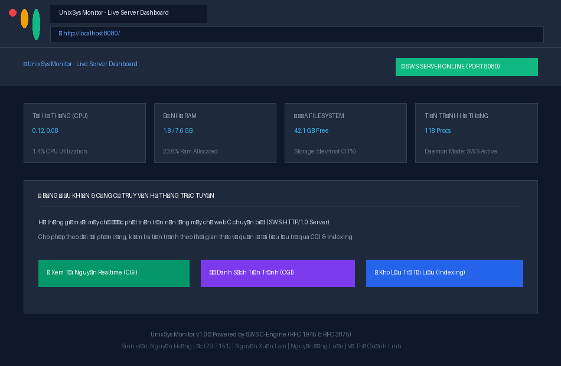
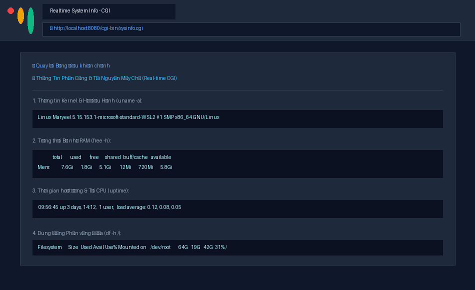
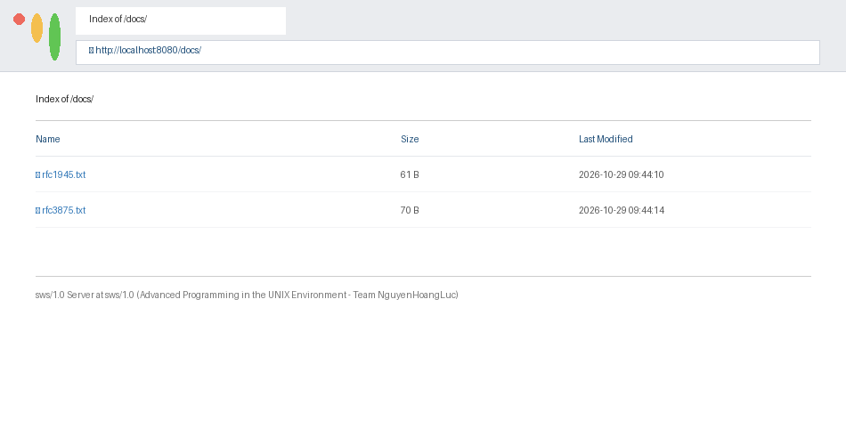

# Web Server Group 6 — UnixSys Monitor
### Simple Web Server (`sws`) with Live System Resource Monitoring
**Môn học:** Lập trình Hệ thống (Advanced Programming in the UNIX Environment - CS631)  
**Đồ án:** Nhóm 6 (Group 6)

---

## 👥 Danh Sách Thành Viên & Phân Chia Đóng Góp (Equal 25%)

| STT | Họ và Tên | Mã Sinh Viên | Vai Trò | Module Đảm Nhiệm | Đóng Góp |
|:---:|:---|:---:|:---:|:---|:---:|
| 1 | **Nguyễn Hoàng Lực** | **23IT151** | Nhóm trưởng | `sws.c`, `sws.h` — Core Server Daemon & Dual-stack IPv4/IPv6 Network | **25%** |
| 2 | **Nguyễn Xuân Lâm** | **23IT152** | Thành viên | `request.c` — HTTP Request Parsing & Security Path Resolution | **25%** |
| 3 | **Nguyễn Đặng Luân** | **23IT153** | Thành viên | `response.c` — HTTP Response Generation, Caching & Directory Indexing | **25%** |
| 4 | **Võ Thị Quỳnh Linh** | **23IT154** | Thành viên | `cgi.c`, Web Dashboard — CGI Execution Engine, Apache Logging & UI/UX | **25%** |

---

## 🌟 Giới Thiệu Dự Án (Project Overview)

Dự án triển khai một máy chủ web độc lập **`sws(1)`** viết bằng ngôn ngữ C chuẩn POSIX, tuân thủ nghiêm ngặt hai đặc tả:
1. **RFC 1945 (HTTP/1.0):** Hỗ trợ phương thức `GET` và `HEAD`, xử lý bộ nhớ đệm có điều kiện `If-Modified-Since` (HTTP 304), mã hóa MIME type chính xác, tự động sinh Directory Listing động khi không có `index.html`.
2. **RFC 3875 (CGI/1.1):** Cơ chế Common Gateway Interface cho phép thực thi kịch bản động với đầy đủ biến môi trường.

Ứng dụng web được tích hợp là **UnixSys Monitor** — Hệ thống giám sát hiệu năng máy chủ Linux thời gian thực với giao diện Dark Mode trực quan, cung cấp thông số CPU load (`uptime`), RAM (`free -h`), Disk (`df -h /`), và danh sách tiến trình đang chạy (`ps aux`).

---

## 📸 Giao Diện & Minh Chứng Hoạt Động

### 1. Dashboard Giám Sát Máy Chủ (Trang Chủ)


### 2. Công Cụ CGI Đo Kiểm Tài Nguyên Thời Gian Thực


### 3. Tự Động Sinh Danh Mục File (Dynamic Directory Indexing)


---

## 🛠️ Tính Năng Kỹ Thuật Nổi Bật

- **Dual-Stack IPv4 / IPv6:** Tự động lắng nghe trên cả IPv4 và IPv6 bằng `getaddrinfo()` và `IPV6_V6ONLY = 0`.
- **Mô hình Đồng thời Đa tiến trình (Multi-process Concurrency):** Phục vụ nhiều client cùng lúc bằng `fork()`, dọn dẹp tiến trình con không đồng bộ qua `SIGCHLD` handler và `waitpid(..., WNOHANG)`.
- **Chế độ Chạy Nền Daemon:** Hỗ trợ tách khỏi terminal điều khiển thông qua `fork()`, `setsid()`, chuyển thư mục gốc `/`, và điều hướng `stdin/stdout/stderr` sang `/dev/null` (trừ khi có cờ `-d` chạy debug).
- **An Toàn & Bảo Mật:**
  - Kiểm tra và ngăn chặn hoàn toàn tấn công Directory Traversal (`/../`).
  - Phân giải an toàn thư mục người dùng `~user` thành `/home/user/sws/` qua hàm `getpwnam()`.
- **Ghi Log Chuẩn Apache Common Log Format:** Định dạng `%a %t "%r" %>s %b` hỗ trợ cờ `-l <logfile>`.

---

## 🚀 Hướng Dẫn Biên Dịch & Chạy (Build & Run)

### Yêu Cầu Môi Trường
- Hệ điều hành: Linux / Ubuntu / WSL / FreeBSD
- Trình biên dịch: `gcc` hỗ trợ chuẩn C11
- Công cụ: `make`

### 1. Biên Dịch Mã Nguồn
```bash
# Biên dịch toàn bộ project
make

# Hoặc biên dịch trực tiếp trong thư mục sws
cd sws
make
```

### 2. Khởi Chạy Web Server
```bash
# Chạy ở chế độ foreground (debug mode -d) trên cổng 8080
./sws/sws -d -p 8080 -c sws/cgi-bin sws/www

# Hoặc chạy dạng Daemon ngầm có ghi log:
./sws/sws -p 8080 -l sws/access.log -c sws/cgi-bin sws/www
```

### 3. Tham Số Dòng Lệnh (`sws` Options)
```text
Cú pháp: ./sws [-dh] [-c dir] [-i address] [-l file] [-p port] dir

Tùy chọn:
  -c dir       Thư mục chứa các tệp thực thi CGI (mặc định: không hỗ trợ CGI)
  -d           Chế độ gỡ lỗi (chạy ở foreground, in thông tin ra terminal)
  -h           Hiển thị trợ giúp cú pháp
  -i address   Ràng buộc địa chỉ IPv4/IPv6 cụ thể (mặc định: lắng nghe tất cả)
  -l file      Tệp ghi nhật ký truy cập (Apache Common Log Format)
  -p port      Cổng dịch vụ lắng nghe (mặc định: 8080)
  dir          Thư mục tài liệu gốc của trang web
```

### 4. Kiểm Thử Tự Động
```bash
make test
```

---

## 📁 Cấu Trúc Thư Mục Dự Án

```text
Webserver-Group6/
├── Makefile                                # Root Makefile (chuyển tiếp lệnh vào sws/)
├── README.md                               # Tài liệu hướng dẫn đồ án
├── .gitignore                              # Cấu hình bỏ qua binary, object file, log
├── NguyenHoangLuc_Lab11_GroupProject.docx  # Báo cáo đồ án định dạng Word
├── NguyenHoangLuc_Lab11_GroupProject.pdf   # Báo cáo đồ án định dạng PDF
├── sws.pdf                                 # Đặc tả yêu cầu đồ án sws
├── 10-http.pdf                             # Tài liệu tham khảo bài giảng HTTP
├── yeucau.md                               # Hướng dẫn chi tiết lab 11
└── sws/                                    # Thư mục mã nguồn C & Tài nguyên web
    ├── Makefile                            # Makefile biên dịch gcc
    ├── sws.h                               # Header khai báo cấu trúc dữ liệu và API
    ├── sws.c                               # [Nguyễn Hoàng Lực] Core Server, Socket, Daemon
    ├── request.c                           # [Nguyễn Xuân Lâm] Parse HTTP Request & Path
    ├── response.c                          # [Nguyễn Đặng Luân] HTTP Response & Indexing
    ├── cgi.c                               # [Võ Thị Quỳnh Linh] Thực thi CGI & Ghi log
    ├── test_server.sh                      # Kịch bản kiểm thử tự động
    ├── demo_home.png                       # Ảnh chụp Dashboard trang chủ
    ├── demo_cgi.png                        # Ảnh chụp kết quả công cụ CGI
    ├── demo_indexing.png                   # Ảnh chụp giao diện Directory Indexing
    ├── make_report_lab11.py                # Script sinh file báo cáo .docx
    ├── make_screenshots.py                 # Script chụp ảnh minh chứng web
    ├── convert_pdf.ps1                     # Script chuyển đổi .docx sang .pdf
    ├── www/                                # Thư mục web tài liệu gốc
    │   ├── index.html                      # Trang chủ UnixSys Monitor Dashboard
    │   └── docs/                           # Thư mục kiểm thử Directory Indexing
    │       ├── rfc1945.txt                 # File tài liệu RFC 1945
    │       └── rfc3875.txt                 # File tài liệu RFC 3875
    └── cgi-bin/                            # Thư mục kịch bản động CGI
        ├── sysinfo.cgi                     # Script CGI giám sát CPU, RAM, Disk
        └── proc.cgi                        # Script CGI hiển thị danh sách tiến trình
```

---

## 📜 Bản Quyền
Dự án được thực hiện bởi **Nhóm 6** cho mục đích học tập và nghiên cứu trong môn học Lập trình Hệ thống.
Mã nguồn phát hành theo giấy phép mã nguồn mở MIT.
